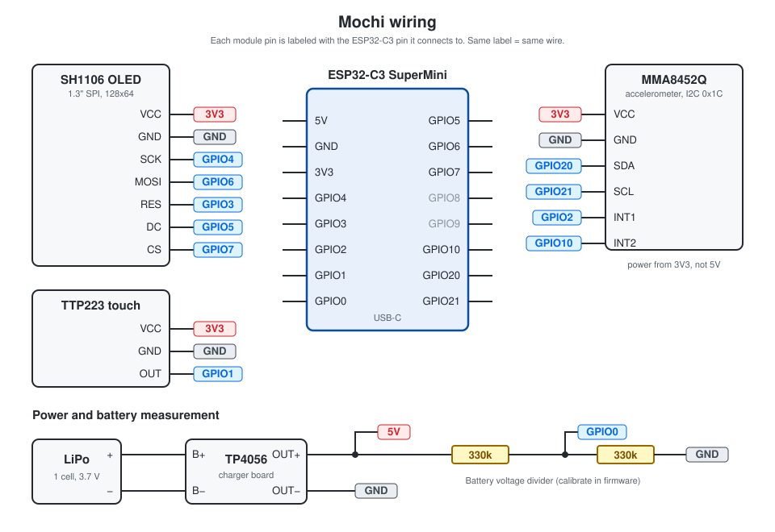

# Mochi

[](https://github.com/Contraill/mochi/actions/workflows/ci.yml)

A small desk companion that shows animated faces on a 128x64 OLED, running on an ESP32-C3. It reacts to touch, petting and shaking; faces, reactions and settings are managed from a web panel you open on your phone.

## Features

- 53 animated faces, compressed to ~820KB in total
- Touch reactions: poke, petting, deep petting
- Accelerometer reactions: soft and hard shake, acceleration, free-fall, tilt, pick-up
- Random idle and event animations that avoid recent repeats
- Web panel in English or Turkish: face gallery, upload/delete, reaction assignments, settings, config import/export
- WiFi access point opened with a tap combo, closes itself after a timeout; password changeable from the web panel
- Battery level, low-battery warnings and charging indicator
- Light, deep and hybrid sleep, woken by touch or a hard shake
- Own animation format (MOC3: delta + RLE compression) and a GIF converter

## Hardware

- ESP32-C3 SuperMini (4MB flash)
- 1.3" SH1106 SPI OLED, 128x64
- TTP223 touch sensor
- MMA8452Q accelerometer
- Single-cell LiPo + TP4056 charger board (the version with OUT+/OUT− and battery protection)
- 2× 330 kΩ resistors (battery measurement)

## Wiring



| Module | Module pin | ESP32-C3 |
|---|---|---|
| SH1106 OLED | VCC | 3V3 |
| | GND | GND |
| | SCK | GPIO4 |
| | MOSI | GPIO6 |
| | RES | GPIO3 |
| | DC | GPIO5 |
| | CS | GPIO7 |
| TTP223 | VCC | 3V3 |
| | GND | GND |
| | OUT | GPIO1 |
| MMA8452Q | VCC | 3V3 |
| | GND | GND |
| | SDA | GPIO20 |
| | SCL | GPIO21 |
| | INT1 | GPIO2 |
| | INT2 | GPIO10 |
| TP4056 | B+ / B− | LiPo + / − |
| | OUT+ | 5V |
| | OUT− | GND |
| Battery divider | OUT+ → 330k → GPIO0 → 330k → GND | GPIO0 |

## Quick start: prebuilt firmware

Pick a file from [Releases](../../releases):

| File | Web panel | Faces |
|---|---|---|
| `mochi-en.bin` | English | none, you upload them from the web panel |
| `mochi-tr.bin` | Turkish | none, you upload them from the web panel |
| `mochi-en-full.bin` | English | all 53 faces and the sample settings preinstalled |
| `mochi-tr-full.bin` | Turkish | all 53 faces and the sample settings preinstalled |

Flash it at offset `0x0`:

- **Browser:** open [ESP Web Flasher](https://espressif.github.io/esptool-js/), click Connect, set the address to `0x0`, pick the file, click Program.
- **Command line:** `esptool --chip esp32c3 write_flash 0x0 mochi-en.bin`

Every file is a full flash image, so it replaces the faces and settings already on the device. With a `-full` file Mochi is ready right away; faces can still be added or removed later from the web panel. The prebuilt firmware uses the default battery calibration; build from source to calibrate it. Then continue with [First start](#first-start).

## Build from source

### 1. Arduino IDE

Install the **esp32** board package (Boards Manager), then these libraries (Library Manager):

- U8g2
- ArduinoJson (v7)
- SparkFun MMA8452Q Accelerometer

Board settings:

- Board: **ESP32C3 Dev Module**
- USB CDC On Boot: **Enabled**
- Flash Size: **4MB**

`partitions.csv` sits in each sketch folder and is used automatically: 1.5MB for the firmware, ~2.4MB LittleFS for faces and settings.

### 2. Pick a language

Each language is a complete, separate sketch. Open only the one you want:

- English: `Mochi_EN/Mochi_EN.ino`
- Turkish: `Mochi_TR/Mochi_TR.ino`

### 3. Configure

At the top of the `.ino` file:

- **`AP_PASSWORD`**: default WiFi password, `example1`. Use at least 8 characters, or the access point won't start. It can also be changed later in the web panel.
- **Battery calibration**: resistor tolerances and ADCs differ between boards, so calibrate your own. Measure the battery with a multimeter, compare it with the voltage in the web panel (System tab), and adjust:
  - `BATTERY_DIVIDER_RATIO`: the divider ratio, 2.0 in theory for two equal resistors
  - `BATTERY_CALIBRATION`: a fine correction multiplier

  The percentage comes from a standard LiPo discharge curve (3.30 V = 0%, 4.20 V = 100%), so only the voltage needs calibrating.

### 4. Upload

Select the port and click Upload.

## First start

Without preinstalled faces, the very first boot finds the face storage (LittleFS) empty, formats it and shows an animated "Hello there!".

1. **Turn on WiFi:** tap Mochi 10 times within 7 seconds. The screen shows the network name and address.
2. **Connect:** join the `R2D2` network from your phone (password `example1`, or your `AP_PASSWORD`) and open `http://192.168.4.1`.
3. **Change the WiFi password** in the **WiFi** tab (see below).
4. **Upload faces:** in the **Faces** tab, tap **Upload Faces** and select every file in `Faces/bins/`. Skip this with a `-full` image.
5. **Pick a default face:** tap **Default/Active** on the face that should play most of the time.
6. **Assign reactions** in the **Animation** tab and save. A `-full` image already has a set of reactions assigned.

WiFi turns off by itself after 15 minutes without a connected device or web panel activity, or when you repeat the 10-tap gesture.

### WiFi password

Everyone who uses the prebuilt firmware starts with the same password, so change it: **WiFi** tab → **WiFi Password**, type the new password twice (8-63 characters, ASCII only), **Save Password**. It takes effect the next time WiFi turns on, so the current connection isn't cut. **Reset to Default** goes back to `AP_PASSWORD`.

Forgot it? Connect Mochi to a computer over USB, open a serial monitor at 115200 baud (Arduino IDE → Tools → Serial Monitor) and turn WiFi on with the tap gesture. The line `[WIFI] ap_start ssid=R2D2 pass=...` shows the password.

## Web panel

| Tab | What's there |
|---|---|
| **Faces** | gallery with live previews, default face, categories, usage filter, upload, delete |
| **Animation** | idle animations, poke / petting / deep petting reactions, opening and random events, sleep and wake animations, accelerometer reactions, touch calibration, playback speed. Every list has a **Test** button that works without saving. |
| **WiFi** | access point status and timeout, WiFi password, the tap combo that opens WiFi, home network credentials |
| **System** | battery and storage, OLED brightness, sleep mode, accelerometer sensitivity and live readings, battery tap combo, config download/upload, sleep test, restart |

## Gestures

| Gesture | Default | Result |
|---|---|---|
| quick tap | shorter than 200 ms | poke reaction |
| hold | 200 ms | petting reaction |
| keep holding | 3 s | deep petting reaction |
| 10 taps within 7 s | | WiFi on/off |
| 5 taps within 5 s | | battery level on screen |
| shake, drop, tilt, pick up | | accelerometer reactions |

All timings and thresholds can be changed in the web panel.

## Making your own faces

`Faces/gif_to_bin.py` converts GIF/PNG/JPG files to Mochi's `.bin` format. It needs Python 3 and Pillow:

```sh
pip install pillow
cd Faces
python gif_to_bin.py                       # every GIF in the folder -> ./bins
python gif_to_bin.py love.gif smirk.gif    # specific files
python gif_to_bin.py --preview -t 120 *.gif
```

Output is 128x64 MOC3 by default. `python gif_to_bin.py --help` lists all options (threshold, invert, fit mode, speed, combining still images). The web panel's **Download Python Script** button serves the same converter if it's on the device.

## Changing the web panel

The panel's source is `web/index_en.html` and `web/index_tr.html`. The firmware embeds it gzip-compressed in each sketch's `Mochi_html.h`, so after editing the HTML run:

```sh
python tools/build_web.py
```

Keep both languages in step: the tests fail if the two panels, or the two sketches, differ in anything other than translated text.

## Documentation

- [Technical overview](docs/technical.md): animation format, compression, event handling, touch, accelerometer, sleep, battery, web API
- [Testing](docs/testing.md): what CI checks, and the manual hardware checklist

## Tests

CI builds both firmwares (and checks they fit the partition), builds and verifies the optional full images, tests the converter and every bundled face, checks that the English and Turkish builds stay in sync, and runs both web panels in a headless browser against a mock device. To run the tests locally:

```sh
pip install pillow pytest playwright littlefs-python
playwright install chromium
pytest tests
```

Pushing a `v*` tag builds all four firmware files and publishes them as a GitHub release.

## Project layout

```
Mochi_EN/           English firmware (sketch, web panel, partition table)
Mochi_TR/           Turkish firmware (sketch, web panel, partition table)
web/                web panel source (HTML), compiled into the sketches
Faces/              face GIFs, ready-to-upload .bin files, converter
tools/              web panel build, full image build and check
docs/               wiring diagram, technical overview, test checklist
tests/              converter, web panel, sync and tool tests
mochi_config.json   sample config (can be uploaded from the web panel)
```

## License

The code is released under the [MIT](LICENSE) license. The MIT license does not cover the animations in `Faces/`.

The GIF animations are property of Dasai and are included here for personal use with the Watcher Mochi project. All rights to the animations belong to Dasai.
